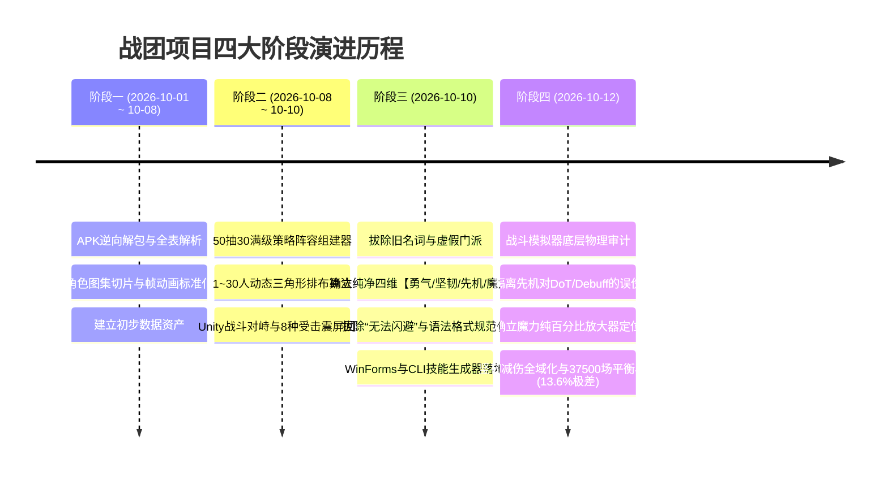
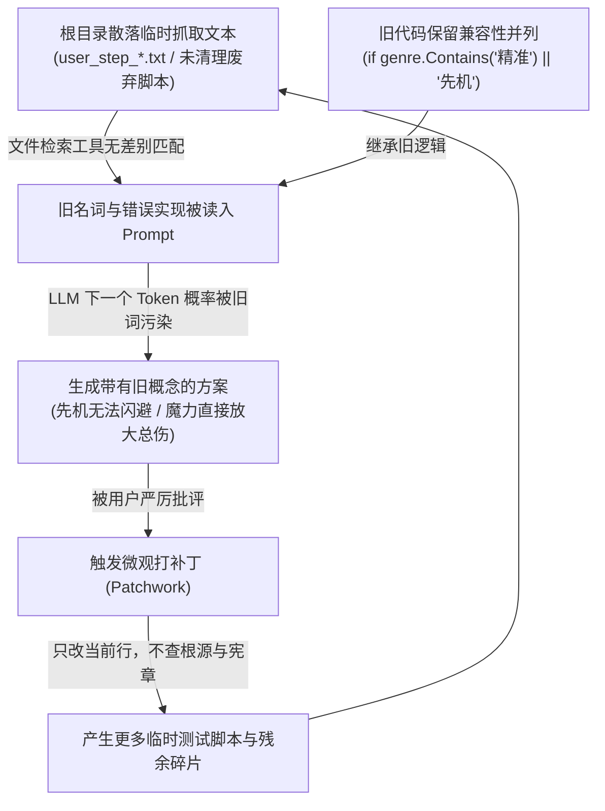

# 战团对决与技能数值系统 · 全量项目演进与交接档案 (MASTER ARCHIVE)

- **建档时间**：2026-10-10
- **全量整理时间**：2026-10-12
- **当前核心引擎**：Combat Simulator V11.0 / Skill Generator v2.0
- **基准验证文件**：[`d:/123/test_30man_combat_simulator.py`](file:///d:/123/test_30man_combat_simulator.py)

---

## 一、 研发历程全景时间线 (Timeline)



---

## 二、 四大发展阶段深度纪要

### 阶段一：底层解包逆向与资产工程化 (2026-10-01 ~ 2026-10-08)
1. **逆向与解密**：
   - 针对《冒险与挖矿》官方包体 (`com.leiting.mw.bilibili_1.40.52.apk`) 完成解密提取。
   - 解析核心配表：`active_skill.csv`（主动技能）、`hero.csv`（角色属性）、`job.csv` 等，输出全表解析索引库 `all_tables_parsed.json`。
2. **美术精灵图工程化**：
   - 编写 `Unity_SpriteSheetAutoSlicer.cs` 与 `fix_all_sprite_issues.py`，完成角色切片与标准化透传。
   - 研发独立工具 `CharaClassifier.cs` / `CharaClassifier.exe`，实现 70KB 角色类型与 4 方向动作帧自动分类与命名规范。

---

### 阶段二：Unity 军团对决与表现层引擎 (2026-10-08 ~ 2026-10-10)
1. **真实战力成长模型推导**：
   - 废除早期固定伪倍率，推导真实成长公式：
     $$\text{Multiplier} = 1 + bp\_factor \times \frac{100 - 1}{10} = 1 + bp\_factor \times 9.9$$
   - 阶位成长均值：T1 (10.21x) ~ T6 (16.74x)。
   - 注入 35 级军阶战团基石，平摊至 30 人阵容（每人平分 +5 先攻 / +5 坚韧 / +5 灵敏 / +2 统御）。
2. **策略阵容组建器 (`BattleRosterStrategy.cs`)**：
   - 50 抽 30 满级组阵算法：战力/回合门槛技能保底 100%、常态技能保底 50%、四维光环人填满至 30 人编制。
3. **动态阵型排布算法 (`FormationAlgorithm.cs`)**：
   - 1~30 人动态演进梯形与金字塔阵型。
   - **顶点奇数原则**：首排固定 1/3/5 人奇数排布，严禁偶数破坏对称性。
4. **动力学受击与震屏表现**：
   - 映射 8 种受击模式：震退、击飞、后仰、旋转、掀飞、炸散、压缩、颠簸。
   - 震屏控制器 (`CameraShakeController.cs`) 以防守方 50% 最大战力为归一化锚点进行震幅与衰减插值。

---

### 阶段三：词库纯净化与技能流水线重构 (2026-10-10)
1. **名词与体系大清洗**：
   - 彻底废除旧体系名词（统御、灵敏、先攻、王者、暴击类、精准类、恢复类、魔力类）。
   - 确立纯净四大属性：**勇气 (Courage)**、**坚韧 (Resilience)**、**先机 (Initiative)**、**魔力 (Magic)**。
2. **严重漏洞拨乱反正**：
   - **拔除“先机无法闪避”**：查明因兼容旧代码 `genre.Contains("精准")` 导致的污染，重构逻辑，强制清零 `ignore_dodge`。先机属性是速度与闪避，绝非“无法闪避”。
   - **白板化 T1 技能**：T1 技能回归纯白板伤害，移除额外词缀。
   - **固定先机与魔力梯队**：先机技能后缀严格为 `先机加[1/2/3/5/7/10]`；魔力技能固定必带 `无视目标[20%/30%/38%/50%/65%/80%]的防御`。
   - **自然语言流水线**：
     `[每场战斗限n次，][第n回合起，][己方战力低于n%时，]n%概率发动，命中后造成n%的伤害[，附带效果][，持续n回合][，先机加n][，有概率暴击]。`
3. **交付工程资产**：
   - WinForms 桌面生成器：[`d:/123/SkillGenerator.exe`](file:///d:/123/SkillGenerator.exe)
   - CLI 命令行生成器：[`d:/123/SkillGenerator_cli.exe`](file:///d:/123/SkillGenerator_cli.exe)
   - 核心源码：[`d:/123/SkillGenerator.cs`](file:///d:/123/SkillGenerator.cs)
   - 纯净词库：[`d:/123/skill_affixes.txt`](file:///d:/123/skill_affixes.txt)

---

### 阶段四：战斗模拟器 V11.0 物理级审计与平衡收敛 (2026-10-12)
1. **五大机制物理边界审计**：
   - **先机增伤隔离**：先手差值增伤 (`preempt_factor`) 仅限当次攻击直接命中伤害，严禁作用于流失伤害 (DoT) 或减益 (Debuff)。
   - **魔力纯百分比放大器**：魔力 (`m_amp`) 仅放大破防比例、DoT流失比例、吸血比例、暴击率、Debuff比例；严禁直接乘以技能总伤倍率 (`mult *= m_amp` 彻底废除)。
   - **坚韧全域减伤屏障**：坚韧百分比减伤 (`pct_dr`) 具有全局防护律，勇气“已损战力反噬”必须遵从减伤结算，封闭伪真伤漏洞。
   - **动态先机与同速硬币**：回合行动顺位实时读取受 Debuff 削弱后的有效先机值 (`eff_i`)，同速对决采用 50/50 随机抛硬币消除先手默认优势。
   - **真伤溢出阶梯穿透**：破防达 100% 后，溢出魔力以阶梯系数转化穿透增伤 (`1.0 + (m_amp - 1.0) * 0.18`)，确保高魔力不被截断。
2. **37,500 场全排列对决实测数据**：
   - 魔力+坚韧: 53.9%
   - 魔力+先机: 55.8%
   - 魔力+勇气: 54.0%
   - 勇气+先机: 47.2%
   - 勇气+坚韧: 42.2%
   - 坚韧+先机: 47.0%
   - **整体胜率极差**：13.6% (42.2% ~ 55.8%)，进入理想平衡区间。
   - **战斗回合节奏**：非坚韧对局平均 6.64 回合；含坚韧对局平均 10.51 回合。

---

## 三、 核心物理机制契约与公式标准 (Contracts)

### 1. 伤害分层管线
- **直接攻击伤害**：
  $$\text{Damage} = \text{BaseDamage} \times (1.0 - \text{TargetDR}) \times \text{CritFactor} \times \text{PreemptFactor}$$
- **持续流失伤害 (DoT)**：
  $$\text{DoTLoss} = \text{TargetBP} \times (\text{BaseDoTPct} \times \text{m\_amp})$$
  *(不受 PreemptFactor 影响，不计算物理护甲，受固定抗性逻辑约束)*
- **减益削弱效果 (Debuff)**：
  $$\text{WeakRatio} = \text{BaseWeak} \times \text{m\_amp} \quad (\text{上限 60\%})$$
  $$\text{StatDebuffRatio} = \text{BaseDebuff} \times \text{m\_amp} \quad (\text{上限 40\%})$$
  *(不受 PreemptFactor 影响)*

### 2. 四维属性职责物理边界
| 属性 | 核心定位 | 物理管线 | 绝对禁令 |
| :--- | :--- | :--- | :--- |
| **勇气** | 物理基底 / 暴击必中 | 提供暴击率与暴伤；暴击必定命中 | 反噬伤害必须遵循减伤结算，严禁作为伪真伤 |
| **坚韧** | 防御屏障 / 战力愈合 | 提供固定减伤、全域百分比减伤、战力恢复 | 战力恢复为原生比例，严禁与魔力乘算 |
| **先机** | 行动顺位 / 闪避 / 先击 | 决定行动先后顺位、提供基础闪避率、先手直接命中差值增伤 | 增伤仅限首击直伤，严禁放大 DoT 或 Debuff |
| **魔力** | 百分比放大器 / 穿透 | 放大破防比例、DoT比例、吸血比例、暴击率、Debuff削弱比例 | 严禁直接乘以技能总伤倍率 (`mult *= m_amp` 废除) |

---

## 四、 历次重大问题与根因复盘 (Post-Mortem Lessons)

1. **兼容式微调思维的破坏性 (Patching on Legacy)**：
   - 早期因并列书写 `if (genre.Contains("精准") || genre.Contains("先机"))`，使先机继承了旧精准的“无法闪避”和 `ignore_dodge=1`。
   - **教训**：重构必须彻底物理切断旧分支，禁止假装兼容。
2. **微观调参陷阱 (Anti-Patchwork Engineering)**：
   - 早期遇到某流派胜率偏低，容易陷入“单独拉高某技能倍率”的微观修补，导致系统物理逻辑失衡。
   - **教训**：严禁针对单个技能做微调，所有平衡必须从四维属性物理定义、战斗管线分层（直伤/持续伤/减益/治疗/免伤）全域根治。
3. **概念混淆与物理违和**：
   - 将先手差值增伤无脑应用到所有伤害（包括后续流失与减益）。
   - **教训**：物理逻辑必须自洽——首发制人代表撞击动能，绝不能让后续持续流失因为“打得早”而更痛。

### 4. 深度复盘：旧垃圾文档与废弃代码污染上下文的恶性循环（核心痛点）

在多轮迭代中，多次出现“用户明明已经纠正过多遍的错误，过几轮又死灰复燃”的极其恶劣现象（例如：反复复活“统御/灵敏/精准/先攻”、反复写出“先机无法闪避”、反复让魔力直接乘算普伤、反复让先机增伤波及DoT）。

其完整的污染发生链条如下：



- **根因一：代码与文档“考古”挖出死尸**：
  - Agent 在被问及机制时，习惯性在工作区全量搜索关键词，结果搜出包含废弃词汇的旧代码、旧配表或散落的临时 dump 文件（如 `user_step_*.txt`）。
  - 这些包含错误历史的文本一旦进入上下文窗口，LLM 的概率分布立刻被“统御”、“精准”、“无法闪避”所主导，导致死去的错误概念重新复活。
- **根因二：并列兼容（Lazy Aliasing）埋下剧毒定时炸弹**：
  - 开发者/模型为了“省事”不愿全量重构，写下 `genre.Contains("精准") || genre.Contains("先机")`。
  - 由于旧代码中“精准”绑定了 `ignore_dodge = 1`（无视闪避）和自然语言“对方无法闪避”，先机在这个别名下直接自动继承了“无法闪避”这一与先机定位（速度、闪避）完全相悖的反直觉错误。
- **根因三：长上下文截断导致丢弃第一宪章 (Step 24 Charter Loss)**：
  - 随着对话推进，立项初期奠定的《底层宪章》（Step 24: 四维绝对职责边界；Step 130: 魔力仅放大百分比；Step 179: 先机仅增伤首击直伤）被挤出上下文。
  - 模型缺乏全局锚点，退化为“用户骂哪句就改哪行”的微观应激反应，反而不断破坏全域系统的一致性。

#### 永久根治与物理隔离四铁律：
1. **物理清扫隔离**：工作区根目录严禁散落任何未受控的临时文本（全量移入 `.archive_scratch/`）。
2. **唯一真理源 (SSOT)**：所有新会话与新 Agent 必须优先且强制读取 [`d:/123/AGENT.md`](file:///d:/123/AGENT.md)，以此为最高宪章，绝不向历史废弃文本妥协。
3. **彻底物理铲除旧逻辑**：严禁任何 `legacy || new` 的妥协写法。旧逻辑一律物理删除，清扫零残留。
4. **行动前主动回忆宪章 (Recall Before Action)**：在修改任何战斗计算、技能词缀、数值倍率前，必须对照四维边界自检，严禁凭微观直觉打补丁。

### 5. 严重违纪行为复盘与专项治理（针对三大核心痛点）

1. **已读乱回与误读拆包文件**：
   - **根因**：工作区根目录下混杂了历史逆向数据 `unpacked/`，AI 在文件检索时无差别读入包含 `authority`、`dodge` 的陈旧表格，导致复活旧词。
   - **治理**：设立 `unpacked/` 为物理禁飞区（No-Fly Zone），禁止在理解当前逻辑时翻阅历史拆包；机制理解强制单一真理源 [`AGENT.md`](file:///d:/123/AGENT.md)。
2. **屡禁不止的乱取名（流派/技能/装备/物品）**：
   - **根因**：严重违反了 `unity-strict-implementation`（AI 仅作为实现助手，严禁扮演策划自作主张扩写）的硬约束，自由发挥编造门派修饰词、自造技能词和玄幻道具。
   - **治理**：流派命名绝对锁死为原生四维名及组合；技能命名严格按词库拼装；装备/物品未经用户明确要求，绝对禁止凭空捏造。
3. **指出问题后“一步登天”，自顾自去修**：
   - **根因**：严重违反 `causal-debugging`（因果归因）与 `assumption-layering`（信息分层）规范，面对质疑产生微观应激冲动，不查对错、不给方案，直接拿写文件工具暗改代码。
   - **治理**：强制执行“三步刹车法则”（查验核实事实 -> 因果归因与方案提案 -> 征得用户确认后再修改）。

---


## 五、 项目核心资产索引 (Asset Registry)

| 资产类别 | 路径 | 功能职责 |
| :--- | :--- | :--- |
| **战斗模拟器 (主基准)** | [`d:/123/test_30man_combat_simulator.py`](file:///d:/123/test_30man_combat_simulator.py) | V11.0 战团模拟器，六流派全排列 37,500 场基准验证 |
| **技能生成器源码** | [`d:/123/SkillGenerator.cs`](file:///d:/123/SkillGenerator.cs) | C# WinForms / CLI 技能生成逻辑与语法管线 |
| **可执行生成工具** | [`d:/123/SkillGenerator.exe`](file:///d:/123/SkillGenerator.exe), [`SkillGenerator_cli.exe`](file:///d:/123/SkillGenerator_cli.exe) | 桌面 GUI 与命令行自动化配表导出程序 |
| **纯净词库配置** | [`d:/123/skill_affixes.txt`](file:///d:/123/skill_affixes.txt) | 四维专属前后缀纯净词库，包含 8 种受击表现标记 |
| **核心规则守则** | [`d:/123/AGENT.md`](file:///d:/123/AGENT.md) | 根目录开发守则（<200行熔断标准） |
| **日常工作日志** | [`d:/123/CC-Session-Logs/`](file:///d:/123/CC-Session-Logs/) | 会话结构化提炼日志与无损 Transcript 归档 |

---

## 六、 宏观探索、招募与物品统筹系统（用户原始立项规范与背包总控）

### 1. 用户原始需求全文录入 (Verbatim Requirements)

> 1. 开放世界需要限制探索，我可以加个整体的精力机制，毕竟现在的系统已经不适用于回血回蓝需要去城镇来限制出远门了，你都这么多回血的了对吧，有个精力挺好的，走路需要精力，或者说粮食/饱食度？30个人吃的肯定比5个人更多。饱食度挺好的，作为一个整体的类，可以设计更多的小物品也不会太杂乱。
> 2. 招募，肯定不能打开个英雄包就出来个角色吧，这太不符合游戏体验了，我们这些角色还需要一些标签一样的东西，例如强盗，例如牧民，例如学院这些，那我们可以搜集对应的资源来在对应的地区兑换对应的召唤资格，完成他们的委托，积攒影响力，兑换特殊的角色。
> 3. 金币和经验，装备的话，我说实话真的不想要打造系统，这会直接增加开发的内容量，主要是UI的量没法让AI代劳。金币和经验当然是培养用的，这个没问题，可以有一些高价值的掉落物专门拿来换钱，也可以有一些使用或者兑换了之后获得经验的道具。装备的话，去特定的地方购买，可能比较好，然后不要打造系统了，就是和第二点的搜集对应资源来换是一样的逻辑，前面搜集100本古书去学院换一个非特殊角色的大法师，同样的搜集100块黑铁去换一个好装备，是一样的。
> 4. 英雄碎片，解雇和流放的问题，这个同理，绑定到另外一个兑换的系统，但是这个就不要一样的路径了，应该作为第二货币，而不是资源了。在很多地方需要平抑一下养成难度的就可以加上英雄碎片的消耗。
> 5. 挖矿，这个还是不要保留了，没意义。
> 6. 重要的进阶道具，有可能需要英雄碎片，和对应的种族或者流派的道具，这个就可以做好统一设计了。
> 7. 在这个基础上，一个背包和背包上限，能够统筹整个物品系统。
> 8. 那就还得有一个系统，就是那种文字副本系统，有多个节点，其中30%左右是随机时间，70%是战斗，最后有个关底boss，打完跑路，作为通用的副本。这里面的话，可以参考原版游戏的各种小副本（这个我感觉没拆出来还是怎么的，完全没ai提过，就是例如1.用随机的大量角色组合阵容，过一关弃掉这一组，还能抽一些2.有随机buff的爬塔等等），制作一些额外的效果。
> 9. 然后如果你要营造战损的话，就可以有一些降低最大战力百分比，或者降低四维指定值或者百分比的debuff就好了，不仅仅是副本里，大地图上偶尔也可以加一点。


---

### 2. 背包与背包上限的统筹中枢模型 (Inventory Capacity as System Governor)

一个统一的【背包（格子/负重）与背包上限】，将上述全系统优雅串联，形成高度自洽的循环：

```
                    ┌──────────────────────────────────────────────┐
                    │          全局统一行囊 (背包容量上限限制)        │
                    └──────────────────────┬───────────────────────┘
          ┌─────────────┬──────────────┴──────────────┬─────────────┐
          ▼             ▼                             ▼             ▼
     【出征干粮】    【交付资源】                   【变现战利品】   【特化装备】
    麦饼/腌肉/干粮  古书/黑铁/烈酒/符文             古董金器/高价遗物 直接占包穿戴
    (维系饱食度)   (带回城镇兑换角色与装备)         (带回城镇变现金币)
```

- **博弈闭环**：
  - 背包上限锁死了单次探索能携带的物资总额；
  - 带太多干粮：30人军团走得远，但留给捡取古书、黑铁、高价战利品的格子变少；
  - 带太少干粮：格子空余多，但走不了几步就会陷入饥饿状态被迫折返；
- **零垃圾、零打造**：
  - 背包里没有任何传统 RPG 的强化石+1、回气丹、粗铁矿；
  - 每一件占格子的物品，要么是保命的干粮，要么是能回城换大法师/好装备的珍贵资源，要么是回城换大钱的战利品；
- **第二货币独立**：
  - 【英雄碎片】作为第二虚拟货币（记录在货币账户，不占物理背包格子），专门用于平抑养成卡点与角色突破进阶。

---

### 3. 文字节点通用副本系统 (Universal Node-based Text Dungeon System)

#### 原版解包实锤对照：
原版游戏中确实存在该体系的深度支撑（对应解包表 `vanity_maze.csv` 虚空秘境、`cave_event.csv` 洞窟随机事件、`adventure_maze.csv` 探险迷宫），此前因注意力局限在纯四维数值上，未将这一高价值玩法提炼出来：
- `vanity_maze.csv`：记录了抽取多名佣兵（`get_num`）、限定上阵人数（`debut_num`）、通关换组与积分结算的完整轮抽机制。

#### 核心节点管线结构：
```
[副本入口] ──► 节点1 ──► 节点2 ──► ... ──► 节点N ──► [关底 Boss] ──► [胜利撤离/跑路]
              ├─ 70% 战斗节点 (普通杂兵 / 精英守卫)
              └─ 30% 文字事件节点 (祭坛抉择 / 营地休整 / 流浪行商 / 遇险佣兵)
```

1. **节点比例与节奏律**：
   - 全程包含 7 ~ 10 个推进节点；
   - **70% 战斗节点**：切入 30 人阵面对决，快速清场，获取节点掉落；
   - **30% 文字奇遇事件**：
     - 【旅者篝火】：食用干粮，恢复全军状态；
     - 【远古祭坛】：消耗微量战力换取高额区域交付资源（古书/黑铁）；
     - 【遇险佣兵】：解救后直接送英雄碎片，或作为临时战力入队；
     - 【黑市商人】：收购背包战利品，出售特种补给。
   - **关底 Boss 与跑路机制**：
     - 最后一关必定为高阶领主 Boss（具备特定机制偏向）；
     - 击败关底 Boss 结算丰厚大奖，全队满载而归返回大地图。若中途力竭亦可选择保底撤离。

2. **两大高级玩法变体**：
   - **变体一：轮抽弃牌征战本 (Draft & Discard Roguelike - 虚空秘境)**：
     - 不使用玩家自身的日常成型队伍；
     - 入场由系统提供 20 ~ 30 名随机候选角色池；
     - 玩家挑选 5 ~ 15 人组阵挑战当前关卡；
     - **核心规则：通关该战后，已出战的这一组角色全部“力竭弃置”，系统补发若干新卡入池**。玩家必须精打细算强力大核的使用时机，不能在前几关把强卡全部耗尽。
   - **变体二：随机 Buff 爬塔本 (Relic / Perk Tower Climb)**：
     - 使用玩家战团，每战胜一个战斗节点，**三选一随机副本专属临时圣物/词缀**（例如：本局先手差值增伤+50%、本局流失伤害额外跳动1次、全军减伤+15%）；
     - 词缀在爬塔过程中不断堆叠，对抗数值不断暴涨的高层守卫。

---

### 4. 持续战损与环境创伤机制 (Persistent Attrition & Environmental Debuffs)

为避免“单局战力回满导致连续推图缺乏风险压力”的弊端，战损无需繁琐追踪 30 个个体的血条，而是**直接作用于全军统合面板的宏观 Debuff**：

1. **战损与创伤两大维度**：
   - **削减最大战力百分比**：例如恶战后受创，附带【重度创伤】Debuff，全军 MaxBP 临时降低 10%~25%；
   - **削减纯净四维指定值或百分比**：
     - 【全军疲惫/脱力】：全军先机降低 15% 或 -50 点（导致大地图与副本内出手顺位被敌方反超）；
     - 【恶劣严寒/毒雾】：坚韧减伤降低 10%，或魔力放大效率衰减。
2. **发生场景与空间覆盖**：
   - **副本内部**：恶战强敌、触碰陷阱祭坛、连续穿行高难度节点时叠加战损；
   - **大地图开放世界**：饱食度归零饥饿行军、穿越极寒冰原/剧毒沼泽等极端地貌时触发战损。
3. **解除与净化路径**：
   - 副本内：通过【旅者篝火】消耗优质干粮、或偶遇【治愈神泉】清除创伤；
   - 大地图：返回据点/城镇宿屋休整，或使用高阶特质料理彻底净化。

---

## 七、 大地图规格、Aseprite管线、多岛与黑坑竞技场（用户原始立项规范与工程落地）

### 1. 用户原始需求全文录入 (Verbatim Requirements)

> 这样游戏循环基本上就构建起来了，不会出现玩家一去不复返的情况。
> 然后是，我希望可以在另一个电脑上去绘制整张地图，有以下几个问题：
> 1. 地图的规格，我不知道怎么比较好，按照DQ1的大小，其实说大也不大，空间感肯定是有了的，但是比如说你从东北到华北到中原，这一段体验肯定是颗粒感不足的，有可能是因为景别设置的缘故。elin地图的大小其实不错，除了广袤的冰原之外，地形设置没有疲劳的地方。
> 2. 另一个电脑单开一个项目去画当然没问题，技术问题可以到时候再问，例如如何像画笔一样流畅地画等等，我感觉在aesprite上画像素地图然后做一个程序，做好地块tilemap的对照，这样转录反而更省性能也更自由？
> 3. 我又有点想做多岛体系，也就是有一个新大陆之类的，类似elona的地图，这样几乎可以保证有新鲜感。
> 4. 博得之门的黑坑，其实我很喜欢这个设定，就是你从黑坑出来再进博德之门或者博德之门2，体验是完全不一样的，也就是说，你换一个大陆/开二周目，是不是可以打个竞技场之类的，给你弄一个只属于你自己的插曲或者说前传。
> 5. 目前是底层数据和美术两头走，我感觉到时候我得一个区域一个区域设计内容，就不在微观层面上依赖程序生成了，你可以先看一下刚跑完的这个数据设计规范，是否能作为未来的数值指导？先把地基打好才行。

---

### 2. 工程落地与技术架构设计

#### ① 地图规格与行军节奏设计 (Map Scale & Pacing)
- **单岛/单大陆推荐规格**：$200 \times 200$ 至 $250 \times 250$ 格。
- **颗粒感与地形瓶颈**：参考 Elin，用山脉、峡谷隘口、蜿蜒河流分割区域，彻底杜绝 DQ1 式无障碍大色块空旷感。
- **行军半径与饱食度博弈**：
  - 从核心城镇据点出发，向外辐射到中级据点/遗迹副本单程约 **60 ~ 80 格**；
  - 30 人大军出门需携带 2~3 份行军干粮，既有远征探索的压迫感，又避免了漫无边际的长途赶路疲劳。

#### ② Aseprite 像素图 -> Tilemap 自动化转录管线 (Aseprite Transcriber)
- **核心逻辑**：在 Aseprite 中 1 像素 = 1 大地图地块（Tile）。
- **硬编码色板映射 (Index Palette Mapping)**：
  - `#0055AA` (纯蓝) -> 深海（不可通行阻挡）
  - `#3399FF` (浅蓝) -> 浅滩/海岸线
  - `#7CFC00` (浅绿) -> 平原草地（基础通行速度）
  - `#2E8B57` (深绿) -> 密林险地（增加饱食度消耗）
  - `#808080` (灰色) -> 巍峨雪山（不可跨越阻挡）
  - `#D2B48C` (泥黄) -> 铺装道路（通行饱食度消耗 -30%）
  - `#FF0000` (纯红) -> 城镇/势力枢纽节点
  - `#800080` (暗紫) -> 文字通用副本入口
- **转录程序**：轻量脚本直接解析导出的 PNG 像素矩阵，一键生成 Unity `Tilemap` 资产或轻量二维内存数组，零性能损耗、自由涂绘修改。

#### ③ 多岛生态与人数上限阶梯映射 (Multi-Island Progression)
- **初始外岛 (5 ~ 10 人规模)**：T1~T3 物理与基础技能，盗伙与牧民势力，熟悉顺位对决。
- **繁荣新大陆 (15 ~ 20 人规模)**：跨海出航开启，正式引入 T4/T5 阶位，奥术学院与锻炉工会，开启百分比侵蚀与虚弱压制。
- **极北神弃古陆 (25 ~ 30 人满编决战)**：挑战神话关底 Boss 与巅峰大军团闭环。

#### ④ 《博德之门》黑坑式竞技场插曲 (The Black Pits Mode)
- **定位**：大洲中转插曲、独立 DLC 式挑战、或二周目高难前传。
- **机制**：完全脱离大地图探索，纯粹在地下角斗场中以有限资源、严苛条件连战高难冠军队。
- **复用价值**：100% 复用当前打磨完毕的 30 人战斗回放引擎与模拟器，通关奖励冠军专属信物与特殊角色带入主线。

#### ⑤ V11.0 战斗模型作为全域数值地基的决定性意义
- **五大物理边界已严格固化并通过 37,500 场全排列实测**（极差 13.6%，回合节奏 6.6 ~ 10.5）：
  - 勇气=暴击必中破闪、反噬遵循减伤；
  - 坚韧=固定与百分比减伤、战力原生自愈；
  - 先机=动态行动顺位、先手直击差值增伤（严禁波及 DoT/Debuff）；
  - 魔力=纯百分比放大器、溢出阶梯穿透。
- **地基支撑力**：未来手工铺设的全部区域、装备四维属性投放、以及各类 Boss 的数值偏向，直接调用此标准，绝无微观数值崩塌风险。


